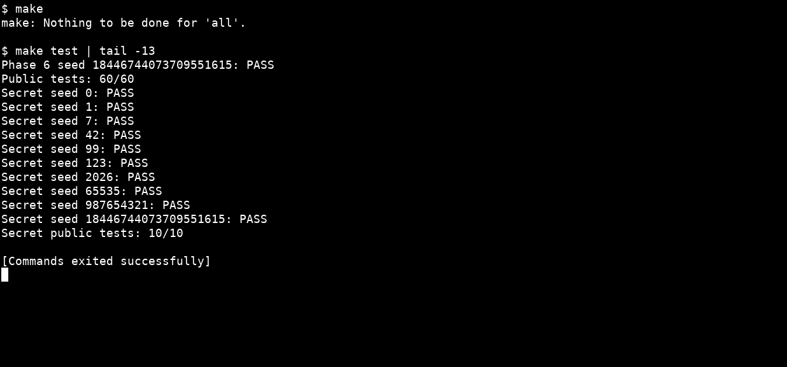
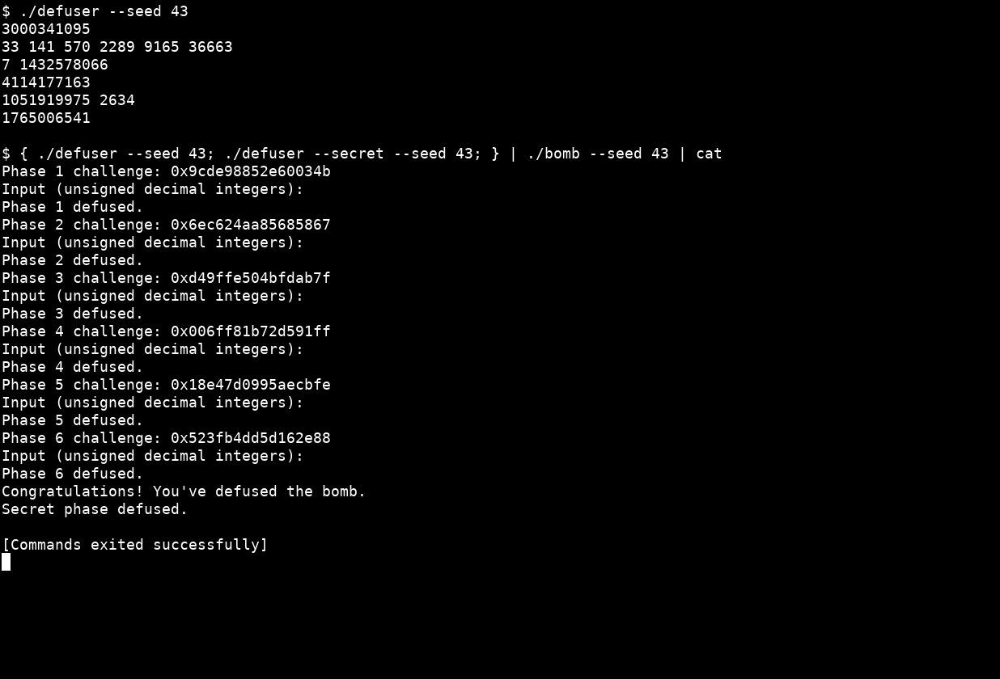

# Lab2 BombLab：个人炸弹分析与验证报告

## 分析方法和整数语义

使用 `nm -n bomb` 定位函数，再用以下方式读取各关及辅助函数：

```sh
objdump -d --no-show-raw-insn --disassemble=phase_01 ./bomb
objdump -d --no-show-raw-insn --disassemble=p1_compute ./bomb
gdb -nx -iex 'set debuginfod enabled off' ./bomb
```

下文汇编均为本炸弹的 AT&T 语法摘录。GDB 在比较指令前观察寄存器和输入数组，也读取第 3、5、6 关的只读表。

统一记号：`C` 表示对应关卡的 challenge；`u32(x)` 表示取低 32 位；所有公式中的 32 位加法、乘法、异或和移位按无符号语义计算。加法和乘法在模 2³² 下回绕。对 `C` 的右移先使用 64 位，再根据公式取低 32 位。`ROR32` 和 `ROL32` 是 32 位循环移位。

正式关卡输出字段数依次为 `1, 6, 2, 1, 2, 1`。`write_answer` 使用 `snprintf` 输出无符号十进制整数和空格，检查容量和截断，不添加换行。

## 第 1 关：调用顺序与参数传递

关键调用片段：

```asm
40205b: shr  $0x20,%rax
402064: shr  $0x10,%rsi
40206b: call p1_step1
402070: mov  %edi,%esi
402072: mov  %edx,%edi
402074: mov  %eax,%ecx
402076: call p1_step0
40207b: mov  %ecx,%esi
40207d: mov  %eax,%edi
40207f: call p1_step2
```

三个辅助函数分别为：

```text
step0(x,y) = (x + 4*y) XOR 0x35f4
step1(x,y) = (3*x + y) XOR 0xb78f
step2(x,y) = 2*x + (y XOR 0xb171)
```

令 `L=u32(C)`、`M=u32(C>>16)`、`H=u32(C>>32)`，则：

```text
a = step1(H,M)
b = step0(L,H)
answer = step2(b,a)
```

`M` 保留的是右移后的低 **32 位**，并非仅取中间 16 位。`step1` 的具体指令没有改写 `edi`，所以返回后 `mov %edi,%esi` 取到的仍是 `H`；不能仅凭调用者保存寄存器的一般规则假定该值已被覆盖。

seed 43 时，在 `0x4020e0` 观察到 `eax=3000341095`，输入位置 `$rbp-0x14` 为同一数，随后第 1 关通过。

## 第 2 关：六元素递推

关键片段：

```asm
402160: shr  $0x26,%rax
402164: and  $0x7f,%eax
402167: add  $0xf,%eax
...
402173: lea  0xf(%rax),%ecx
402179: shr  %cl,%rdx
40217c: and  $0xf,%edx
40217f: xor  %eax,%edx
402181: lea  (%rdx,%rsi,4),%edx
402184: mov  -0x40(%rbp,%rax,4),%esi
402188: cmp  %edx,%esi
```

首次比较检查数组首项，随后 `rax` 从 1 递增到 5。恢复出的关系是：

```text
v[0] = ((C >> 38) & 127) + 15
v[i] = 4*v[i-1] + (((C >> (15+i)) & 15) XOR i), i=1..5
```

需要保留“取低 4 位后再异或下标”的顺序。seed 43 的数组是 `33 141 570 2289 9165 36663`；GDB 在 `0x402196` 读取 `$rbp-0x40` 开始的六个 4 字节元素，与生成的数组一致。

## 第 3 关：跳转表

入口从 `C` 的低 3 位确定第一个字段，并构造传给分派函数的数值：

```asm
402301: and  $0x7,%edi
402304: cmp  %edi,-0x18(%rbp)
40230f: shr  $0x3,%rax
402313: shr  $0x20,%rsi
402317: xor  %eax,%esi
402319: call p3_dispatch
```

分派通过 `notrack jmp *0x405820(,%rax,8)` 实现。读取八个表项，再跟踪各跳转桩，得到下面的真实映射；函数名的末尾编号不能直接作为输入下标。

令 `j=C&7`、`x=u32(C>>3) XOR u32(C>>32)`：

| j | 实际函数 | 第二个字段 |
| --- | --- | --- |
| 0 | `p3_case_3` | `(4*x) XOR 0x1bf6` |
| 1 | `p3_case_7` | `5*x + 0x1d4c` |
| 2 | `p3_case_1` | `(x XOR 0x8e8f) + (x>>2)` |
| 3 | `p3_case_6` | `(4*x) XOR 0x3bd2` |
| 4 | `p3_case_4` | `(x XOR 0xe22b) + (x>>1)` |
| 5 | `p3_case_2` | `3*x + 0xd12a` |
| 6 | `p3_case_5` | `3*x + 0x2513` |
| 7 | `p3_case_0` | `5*x + 0x1efd7` |

输出为 `j answer`。seed 43 的 `j=7`；在 `0x40231e`，`eax=1432578066`，输入为 `7 1432578066`，该关通过。

## 第 4 关：二分递归和回溯

`phase_04` 设置 `target=C&127`、区间 `[0,127]` 和 `salt=u32(C>>7) XOR u32(C>>32)`，然后调用 `p4_walk`。

关键片段：

```asm
402338: sub  %esi,%edi
40233a: shr  $1,%edi
40233c: add  %esi,%edi
40233e: cmp  %eax,%edi
...
40235c: lea  (%rax,%rax,4),%eax
40235f: xor  %ebx,%eax
402366: xor  $0xa,%eax
...
40237a: lea  (%rax,%rax,4),%eax
40237d: xor  %ebx,%eax
402384: xor  $0x6,%eax
...
402390: lea  0x22(%rdi),%eax
402393: xor  %ecx,%eax
```

令 `m=low+((high-low)>>1)`，递归关系为：

```text
F(t,l,h,s) = (m+0x22) XOR s                         若 t=m
           = (5*F(t,l,m-1,s)) XOR (m+s) XOR 6       若 t<m
           = (5*F(t,m+1,h,s)) XOR (m+s) XOR 10      若 t>m
```

只沿包含目标的一侧递归，再在返回过程中组合结果。左右分支的常量不同。目标始终在 `[0,127]`，因此递归终止，最深路径访问 8 个中点。seed 43 的目标为 127；在 `0x40240a` 观察到 `eax=4114177163`，与输入一致。

## 第 5 关：结构体和链表

`p5_nodes` 从 `0x405ba0` 开始，每个节点占 16 字节：

```text
+0: uint32_t value
+4: uint32_t tag
+8: 8-byte next pointer
```

关键片段：

```asm
402434: mov  0x405b60(,%rax,8),%rdx
402447: mov  0x4(%rdx),%esi
40244c: xor  (%rdx),%eax
402450: xor  $0x6fdf,%eax
402458: add  %esi,%eax
...
402464: mov  0x8(%rdx),%rdx
40246b: mov  0x4(%rdx),%esi
40246e: xor  (%rdx),%eax
402470: add  %esi,%eax
```

下面用相对 `p5_nodes` 的节点编号表示链接，避免把运行地址作为求解程序中的指针：

| 节点 | value（十六进制） | tag（十六进制） | next |
| --- | --- | --- | --- |
| 0 | 71ff | 017 | 1 |
| 1 | 14fb | 60c | 10 |
| 2 | f0dd | 844 | 5 |
| 3 | 8a93 | 545 | NULL |
| 4 | 27f9 | 97d | 7 |
| 5 | bd4f | 125 | 0 |
| 6 | 490f | 418 | 3 |
| 7 | e444 | 264 | 9 |
| 8 | 023d | 37a | 4 |
| 9 | 8479 | a4a | 6 |
| 10 | e651 | b6c | 8 |
| 11 | 9515 | 71a | 2 |

`p5_heads` 的八个入口依次为 `[11,2,5,0,1,10,8,4]`。令：

```text
node = heads[C&7]
steps = (C>>3)&3
acc = u32(C>>6) XOR u32(C>>32) XOR 0x6fdf
```

首先处理入口节点，然后沿 `next` 再移动 `steps` 次。每访问一个节点执行 `acc=(acc XOR value)+tag`，最后输出 `acc` 和最后访问节点的 `tag`。总访问数为 `steps+1`，步数为零时仍需处理入口节点。

seed 43 选中入口 6，即节点 8，遍历 `8→4→7→9`，输出 `1051919975 2634`。在 `0x4024dc`，`edx=1051919975`，局部保存的末节点 tag 为 2634，与两个输入字段一致。

## 第 6 关：函数指针表与两次间接调用

关键片段：

```asm
402590: and  $0x38,%ebx
402593: and  $0x7,%eax
402596: call *0x405e00(,%rax,8)
40259d: xor  $0xf7cf,%eax
4025a2: mov  %eax,%edi
4025a4: call *0x405e00(%rbx)
4025af: add  $0x51f8,%eax
```

八项函数指针表的实际顺序为 `[op2,op1,op3,op4,op5,op4,op4,op0]`，其中存在重复项。各函数为：

| 函数 | 运算 |
| --- | --- |
| op0 | `ROL32(x,2) XOR 0xb2a5` |
| op1 | `ROR32(x,5)` |
| op2 | `(x+0x59a) XOR (x>>5)` |
| op3 | `(8*x+0xafcc) XOR (7*x)` |
| op4 | `(x XOR 0xcdea) + 8*x` |
| op5 | `(x XOR (x>>2)) + 0x5325` |

令 `i=C&7`、`j=(C>>3)&7`、`x=u32(C>>6) XOR u32(C>>32)`，结果为：

```text
answer = ops[j](ops[i](x) XOR 0xf7cf) + 0x51f8
```

第二次调用使用 `(C&0x38)` 作为字节偏移，等价于上述 `j`。seed 43 使用 `ops[0]=op2` 和 `ops[1]=op1`；在 `0x402610` 观察到 `eax=1765006541`，与输入一致。

## Honor：相邻字段覆盖和 context 校验

### 入口布局

六关全部通过后，用管道或文件提供第七行。`secret_gate` 的关键片段是：

```asm
40272b: lea  -0xd0(%rbp),%r12
...
402751: sub  $0x24,%rax
402755: cmp  $0x7f,%rax
402759: jbe  402770
...
402776: call secret_copy
40277b: cmpl $0x4e45504f,-0xb0(%rbp)
...
40278d: lea  -0xac(%rbp),%rdi
402794: call secret_phase
```

`strlen(line)-36 <= 127` 是无符号比较，因而接受长度为 36～163 的文本。原始 `secret_copy` 逐字节复制，直到连同 NUL 一起复制完成。

相对复制起点 `$rbp-0xd0`：偏移 0～31 为前缀，偏移 32～35 必须等于小端常量 `0x4e45504f`，即字符 `OPEN`；偏移 36 起交给 `secret_phase`。因此构造：

```text
32 个 A + OPEN + mode 的十进制 + 空格 + first 的十进制 + 空格 + second 的十进制
```

最终长度最多 59 字节，连同 NUL 远小于入口局部对象和输出缓冲区容量。该输入只覆盖题目设计的相邻字段，不覆盖返回地址，不使用 shellcode。

### 三个数值

令 `K` 为 Honor challenge，`T` 为由公共驱动根据六行整数计算的 context：

```text
mode = u32(T)&3
a = u32(K) XOR u32(K>>32)
b = u32(T) XOR u32(T>>32)
first = ROR32(a XOR b,1) XOR 0x575f
        XOR (mode*0x567c) XOR u32(T>>16)
second = first XOR ((a>>1)+b+mode+0x123)
```

关键汇编：

```asm
402695: and  $0x3,%ecx
4026a0: imul $0x567c,%ecx,%r9d
4026b8: shr  $0x10,%r13
4026be: xor  %r13d,%r9d
4026c4: call secret_mix
4026c9: xor  %r9d,%eax
...
4026d1: shr  $1,%esi
4026d3: lea  0x123(%r8,%rcx,1),%edx
4026db: add  %esi,%edx
4026dd: xor  %edx,%eax
```

`secret_mix` 是 `ROR32(x,1) XOR 0x575f`。`u32(T>>16)` 包含 context 第 16～47 位，不能只取一个 16 位字段。context 已由驱动传入，无需在求解函数内读取前六行或调用外部程序。

seed 43 的 GDB 观察值为：

```text
K = 0xe22a53d064a0b63a
T = 0x00530d720c109fc5
mode = 1
first = 3356931741
second = 2275389517
```

在原始 `secret_copy` 返回后，观察到标记确实为 `O P E N`，传给 `secret_phase` 的文本为 `1 3356931741 2275389517`。两次数值比较一致，最后正常输出 `Secret phase defused.`。

## 验证记录和截图

### 官方公开测试

```sh
make
make test
```

结果：`Public tests: 60/60`、`Secret public tests: 10/10`，退出码为 0。截图通过真实终端执行命令，`tail -13` 只用于让汇总结果和 Honor 的十个结果在同一屏显示。



### 公开列表以外的 seed

`tests/public.json` 中的十个 seed 为 `0,1,7,42,99,123,2026,65535,987654321,18446744073709551615`。下面的 **43 不在该列表中**，每一关均单独有验证记录：

| 关卡 | seed 43 的 challenge | 生成的口令 | 结果 |
| --- | --- | --- | --- |
| 1 | `0x9cde98852e60034b` | `3000341095` | Phase 1 defused. |
| 2 | `0x6ec624aa85685867` | `33 141 570 2289 9165 36663` | Phase 2 defused. |
| 3 | `0xd49ffe504bfdab7f` | `7 1432578066` | Phase 3 defused. |
| 4 | `0x006ff81b72d591ff` | `4114177163` | Phase 4 defused. |
| 5 | `0x18e47d0995aecbfe` | `1051919975 2634` | Phase 5 defused. |
| 6 | `0x523fb4dd5d162e88` | `1765006541` | Phase 6 defused. |
| Honor | `0xe22a53d064a0b63a` | 32 个 A 后接 `OPEN1 3356931741 2275389517` | Secret phase defused. |

完整验证命令：

```sh
{ ./defuser --seed 43; ./defuser --secret --seed 43; } | ./bomb --seed 43
```

截图中末尾额外接了 `| cat`，使炸弹的标准输出也成为管道，关闭仅在终端显示的长篇故事，保留实际的 challenge 和通关结果；没有改变输入或校验。



## 资料与辅助工具说明

- [课程 Lab2 作业说明](https://ics-26fall-fdu.github.io/labs/lab2-bomb-lab/)：关卡目标、接口、测试、Honor 和报告要求。
- [BombLab 模板 README](https://github.com/ICS-26Fall-FDU/BombLab/blob/main/README.md)：解法文件边界、运行方法、报告要求。
- 本目录个人 `bomb`：关键汇编、跳转表、链表及函数指针表的原始依据；`defuser.h` 和 `challenge.c` 用于确认接口与 context 来源。

辅助工具及用途：

- GNU binutils 的 `nm`、`objdump`：定位符号、读取关键汇编以及跳转表、链表和函数指针表。
- GDB：在关键比较位置设置断点，观察寄存器、输入字段和内存布局，核对分析得到的计算关系；未修改炸弹内部状态来绕过校验。
- GCC、GNU Make、Python 3 和课程提供的公开测试程序：编译解法并验证运行结果；扩展复核使用 Python 驱动原始炸弹，并用 `ctypes` 检查求解接口的缓冲区边界。
- AI：仅用于交付前检查，帮助撰写实验报告，检查提交材料完整性。

各关的分析思路和求解代码由本人独立完成，AI 未参与生成各关思路或解法。
